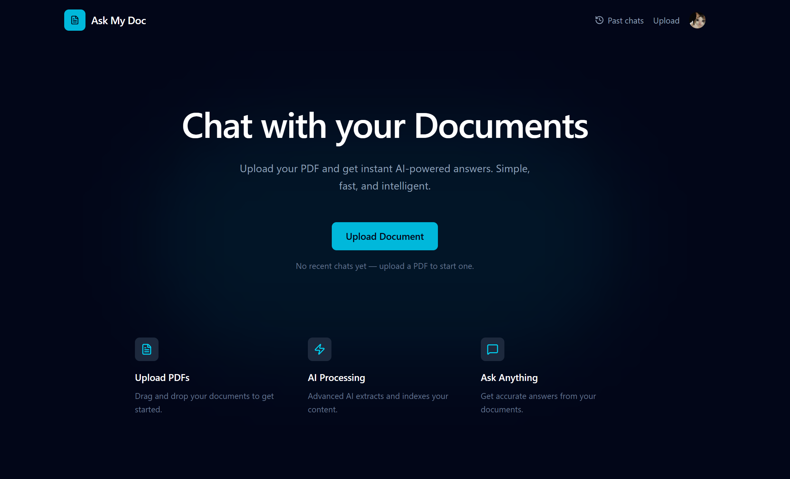
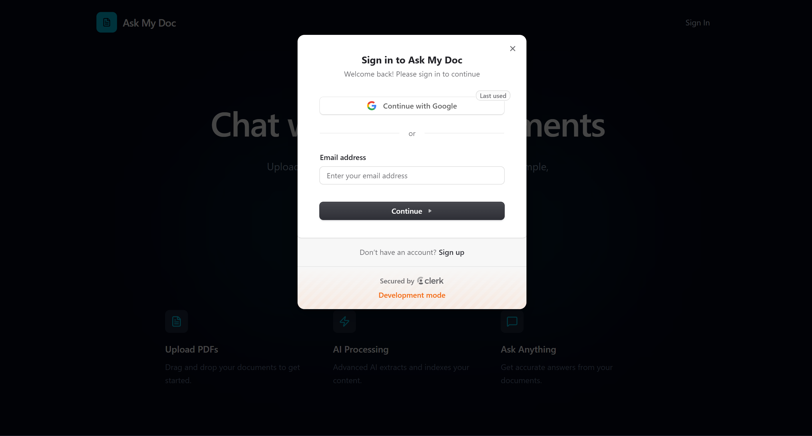
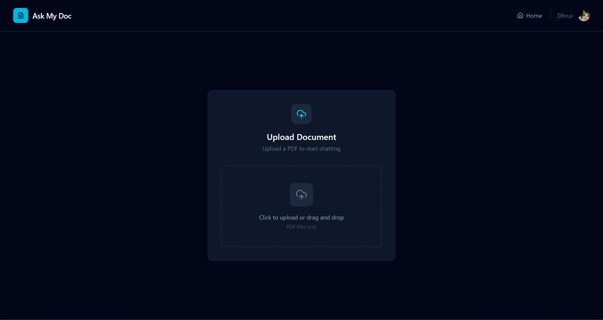
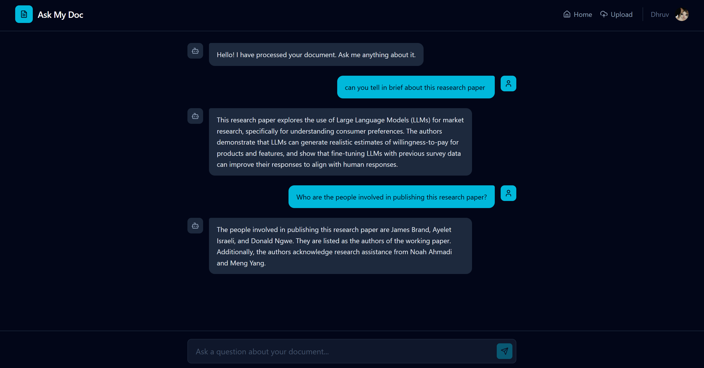

<p align="center">
  
</p>

<h1 align="center">Ask My Doc</h1>

<p align="center">
  <strong>Chat with your PDF Documents using AI</strong>
</p>

<p align="center">
  Upload a PDF, ask questions, and get accurate answers grounded in the document — with full conversation history, multiple chats, and a clean modern interface.
</p>

<p align="center">
  <a href="#overview">Overview</a> •
  <a href="#features">Features</a> •
  <a href="#ragas-evaluation">Evaluation</a> •
  <a href="#tech-stack">Tech Stack</a> •
  <a href="#architecture">Architecture</a> •
  <a href="#getting-started">Getting Started</a> •
  <a href="#api-reference">API Reference</a> •
  <a href="#project-structure">Project Structure</a>
</p>

---

## Overview

**Ask My Doc** is a full-stack RAG (Retrieval-Augmented Generation) application that lets users upload PDF documents and have intelligent, grounded conversations about their content. The system retrieves the most relevant chunks from a vector database and feeds them to a large language model, producing answers that are strictly tied to the source document.

The pipeline has been evaluated with the Ragas framework on 50 real conversation turns and achieves a **Faithfulness score of 0.9771**, confirming near-zero hallucination in practice.

---

## Features

**Document Management**
- PDF upload with drag-and-drop or click-to-upload interface
- Fast document processing with real-time progress feedback
- Each uploaded document gets its own isolated namespace in the vector database

**AI-Powered Chat**
- Natural language conversations grounded in the uploaded document
- Semantic search using vector embeddings — retrieves the top 4 most relevant chunks per query
- Strict hallucination guardrails: the model explicitly refuses to answer out-of-scope questions
- Context-aware responses using full conversation history

**Persistent Multi-Chat System**
- All conversations are saved to MongoDB automatically
- Create multiple independent chat sessions per document
- Switch between any previous conversation at any time from the sidebar
- Chat titles, message counts, and timestamps are preserved across sessions
- Each message stores the retrieved context chunks alongside the response, enabling offline evaluation

**User Experience**
- Secure authentication powered by Clerk
- Modern dark-themed interface with a responsive sidebar for chat management
- Intuitive navigation: Land, Sign In, Upload, Chat

---

## Screenshots

### Landing Page



### Authentication



### Upload Page



### Chat Interface



---

## RAGAS Evaluation

The RAG pipeline quality is measured using [Ragas](https://docs.ragas.io/), an open-source framework for evaluating retrieval-augmented generation systems. Evaluation runs against real conversation turns stored in MongoDB — no synthetic test sets required.

### Results

| Metric | Score | What It Measures |
|---|---|---|
| **Faithfulness** | **0.9771** | Whether each statement in the answer is supported by the retrieved context. A score near 1.0 means near-zero hallucination. |
| **Answer Relevancy** | **0.8358** | Whether the answer addresses the question asked. Scores above 0.80 are considered strong for open-ended document Q&A. |

### Evaluation Proof


### How the Evaluation Works

1. Real user questions and assistant answers are read from MongoDB
2. Each assistant message has the retrieved context chunks saved at chat time
3. Ragas evaluates Faithfulness by checking whether each answer statement is supported by the context
4. Ragas evaluates Answer Relevancy by measuring semantic similarity between the original question and the answer
5. Results are exported to `ragas_live_chat_report.csv`

### Running the Evaluation

```bash
cd Backend

# Evaluate all stored conversation turns
python evaluate_rag.py

# Evaluate only the first N turns (recommended to stay within API rate limits)
python evaluate_rag.py --limit 10

# Evaluate a specific conversation by its MongoDB ID
python evaluate_rag.py --conv-id <conversation_id>

# List all stored conversations
python evaluate_rag.py --list-chats
```

---

## Tech Stack

### Frontend

| Technology | Version | Purpose |
|---|---|---|
| React | 19 | UI Framework |
| Vite | 7 | Build Tool and Dev Server |
| Tailwind CSS | 4 | Styling |
| React Router | 7 | Client-side Routing |
| Clerk | Latest | Authentication |
| Axios | Latest | HTTP Client |
| Lucide React | Latest | Icons |

### Backend

| Technology | Purpose |
|---|---|
| FastAPI | Python web framework |
| LangChain | LLM orchestration |
| Pinecone | Vector database for semantic search |
| Google Gemini | Text embeddings (gemini-embedding-001) |
| Groq | LLM inference for chat responses |
| MongoDB | Persistent storage for conversations and documents |
| PDFPlumber | PDF text extraction |
| Ragas | RAG pipeline evaluation framework |
| Uvicorn | ASGI server |

---

## Architecture

```
+-----------------------------------------------------------------------------------+
|                                   FRONTEND                                        |
|  +-------------+   +-------------+   +-------------+   +---------------------+   |
|  |   Landing   |-->|    Auth     |-->|   Upload    |-->|  Chat (Sidebar +    |   |
|  |    Page     |   |   (Clerk)   |   |    Page     |   |  Multi-Chat Panel)  |   |
|  +-------------+   +-------------+   +-------------+   +---------------------+   |
|              React 19 + Vite 7 + Tailwind CSS 4 + React Router 7                 |
+------------------------------------------+----------------------------------------+
                                           | HTTP / REST
                                           v
+-----------------------------------------------------------------------------------+
|                                   BACKEND (FastAPI)                               |
|                                                                                   |
|   POST /upload                          POST /chat                                |
|        |                                     |                                    |
|        v                                     v                                    |
|   PDF Processing                        RAG Pipeline                              |
|   - PDFPlumber extract                  - Embed query (Gemini)                   |
|   - RecursiveCharacterTextSplitter      - Retrieve top-4 chunks (Pinecone)       |
|   - Embed chunks (Gemini)               - Build prompt with history               |
|   - Store in Pinecone (namespace        - Generate answer (Groq LLM)             |
|     per documentId)                     - Save Q/A + contexts to MongoDB          |
|   - Save metadata to MongoDB            - Return answer to frontend               |
|                                                                                   |
+---------------------------+----------------------------+----------------------------+
                            |                            |
                            v                            v
               +------------------+          +---------------------+
               |    Pinecone      |          |      MongoDB        |
               |  Vector Database |          |  - documents        |
               |  (document       |          |  - conversations    |
               |   embeddings)    |          |  - messages +       |
               +------------------+          |    contexts         |
                                             +---------------------+
```

### System Workflow

1. **Document Upload** — User uploads a PDF through the frontend
2. **Text Extraction** — PDFPlumber extracts raw text from the PDF
3. **Chunking** — Text is split with `RecursiveCharacterTextSplitter`
4. **Embedding** — Each chunk is embedded via Google Gemini
5. **Vector Storage** — Embeddings are stored in Pinecone, namespaced by `documentId`
6. **Query Processing** — The user's question is embedded and used to retrieve the top 4 most relevant chunks
7. **Answer Generation** — A grounded prompt (with retrieved chunks and conversation history) is sent to the Groq LLM
8. **Persistence** — The question, answer, and retrieved contexts are saved to MongoDB for future sessions and Ragas evaluation

---

## Getting Started

### Prerequisites

- Node.js 18 or higher
- Python 3.9 or higher
- pip
- npm or yarn
- MongoDB (local instance or Atlas)

### Required API Keys

| Service | Purpose | Link |
|---|---|---|
| Clerk | Authentication | [clerk.com](https://clerk.com) |
| Pinecone | Vector Database | [pinecone.io](https://www.pinecone.io) |
| Google AI | Embeddings | [ai.google.dev](https://ai.google.dev) |
| Groq | LLM Inference | [console.groq.com](https://console.groq.com) |

### Installation

#### Step 1: Clone the Repository

```bash
git clone https://github.com/dhruv0050/ask-my-doc.git
cd ask-my-doc
```

#### Step 2: Backend Setup

```bash
cd Backend

# Create and activate a virtual environment
python -m venv venv

# Windows
venv\Scripts\activate
# macOS / Linux
source venv/bin/activate

# Install dependencies
pip install -r requirements.txt
```

Create a `.env` file in the `Backend` directory:

```env
PINECONE_API_KEY=your_pinecone_api_key
GEMINI_API_KEY=your_google_ai_api_key
GROQ_API_KEY=your_groq_api_key
GROQ_MODEL=openai/gpt-oss-20b
EMBEDDING_MODEL_NAME=models/gemini-embedding-001
MONGODB_URI=mongodb://localhost:27017
MONGODB_DATABASE=AskMyDoc
```

#### Step 3: Frontend Setup

```bash
cd ../Frontend
npm install
```

Create a `.env` file in the `Frontend` directory:

```env
VITE_CLERK_PUBLISHABLE_KEY=your_clerk_publishable_key
```

#### Step 4: Pinecone Index Configuration

Create a Pinecone index with the following settings:

- **Index Name**: `ask-my-doc`
- **Dimensions**: `768` (required for Gemini embeddings)
- **Metric**: `cosine`

### Running the Application

```bash
# Terminal 1 — Backend
cd Backend
python main.py
# Server starts at http://localhost:8000

# Terminal 2 — Frontend
cd Frontend
npm run dev
# App available at http://localhost:5173
```

---

## API Reference

### Base URL

```
http://localhost:8000
```

### Endpoints

#### Health Check

```http
GET /
```

Response:
```json
{ "message": "Server is running" }
```

---

#### Upload Document

```http
POST /upload
```

Content-Type: `multipart/form-data`

Parameters:
- `file` (required) — PDF file
- `userId` (required) — Clerk user ID

Response:
```json
{
  "filename": "document.pdf",
  "documentId": "abc123",
  "status": "Uploaded & Processed Successfully",
  "chunks_created": 42
}
```

---

#### Chat

```http
POST /chat
```

Request body:
```json
{
  "query": "What is the main contribution of this paper?",
  "documentId": "abc123",
  "conversationId": "conv_xyz",
  "history": [
    { "role": "user", "content": "Previous question" },
    { "role": "assistant", "content": "Previous answer" }
  ]
}
```

Response:
```json
{
  "answer": "The main contribution is..."
}
```

---

#### Get Conversations

```http
GET /conversations?documentId=abc123
```

Returns all saved conversations for a given document, with titles and message counts.

---

#### Get Messages

```http
GET /conversations/{conversationId}/messages
```

Returns the full message history for a specific conversation.

---

## Project Structure

```
Ask My Doc/
├── Backend/
│   ├── main.py              # FastAPI server and all endpoints
│   ├── utils.py             # RAG pipeline, embeddings, retriever, system prompt
│   ├── evaluate_rag.py      # Ragas evaluation runner (dev tool, not user-facing)
│   ├── requirements.txt     # Python dependencies
│   └── .env                 # Environment variables (not tracked)
│
├── Frontend/
│   ├── public/
│   │   ├── logo.png
│   │   ├── landing.png
│   │   ├── auth_clerk.png
│   │   ├── upload.png
│   │   ├── chat.png
│   │   └── RAGAS eval.png   # Evaluation output screenshot
│   │
│   ├── src/
│   │   ├── pages/
│   │   │   ├── Landing.jsx  # Landing page
│   │   │   ├── Upload.jsx   # Document upload page
│   │   │   └── Chat.jsx     # Chat interface with multi-chat sidebar
│   │   │
│   │   ├── App.jsx          # Routing configuration
│   │   ├── main.jsx         # React entry point
│   │   └── *.css            # Stylesheets
│   │
│   ├── package.json
│   ├── vite.config.js
│   └── .env                 # Environment variables (not tracked)
│
└── README.md
```

---

## Security

- All upload and chat routes are protected by Clerk authentication
- User isolation: each document is namespaced by `documentId` in Pinecone and linked to a user in MongoDB
- API keys are stored in `.env` files and never committed to version control
- Route guards prevent unauthenticated access to protected pages
- CORS middleware restricts cross-origin requests

---

## License

This project is open source and available under the [MIT License](LICENSE).

---

## Acknowledgments

- [LangChain](https://langchain.com/) — LLM orchestration framework
- [Ragas](https://docs.ragas.io/) — RAG evaluation framework
- [Clerk](https://clerk.com/) — Authentication
- [Pinecone](https://www.pinecone.io/) — Vector database
- [Groq](https://groq.com/) — LLM inference
- [Google AI](https://ai.google.dev/) — Embedding models
- [FastAPI](https://fastapi.tiangolo.com/) — Python web framework
- [React](https://react.dev/) — UI library
- [Tailwind CSS](https://tailwindcss.com/) — CSS framework

---

<p align="center">
  Made by <a href="https://github.com/dhruv0050">@dhruv0050</a>
</p>

